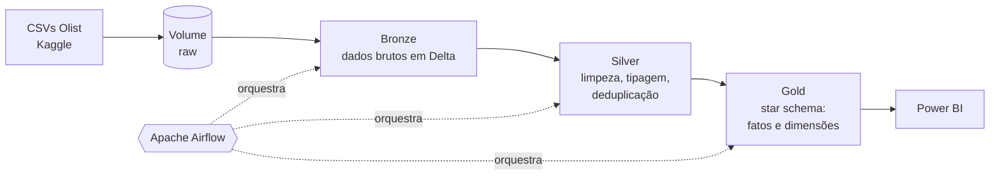
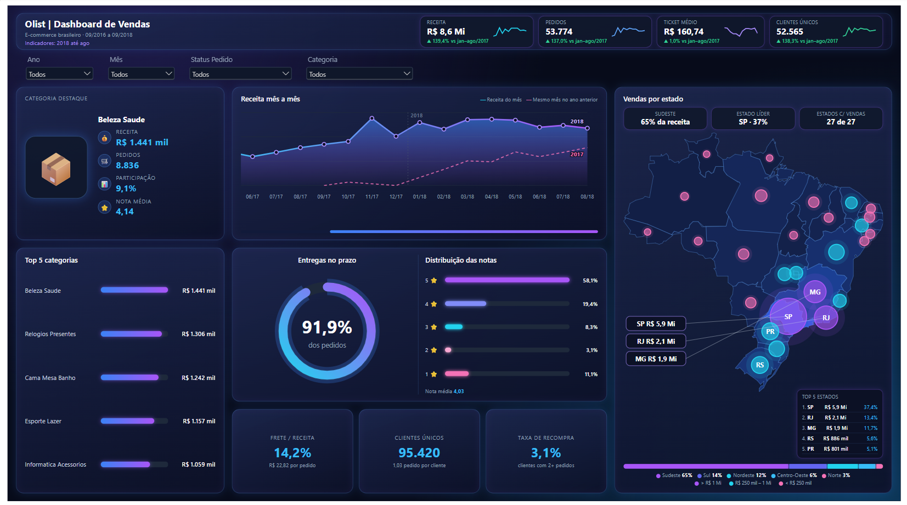
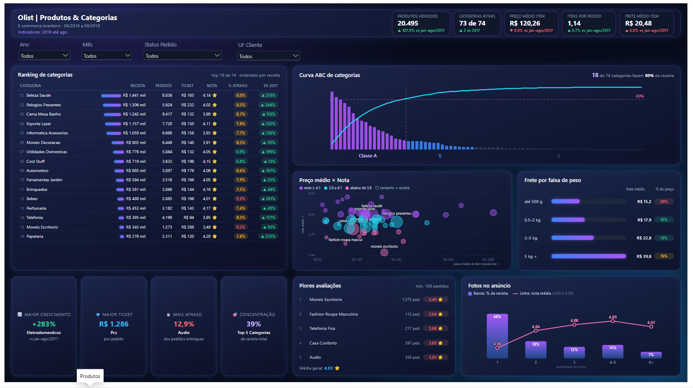
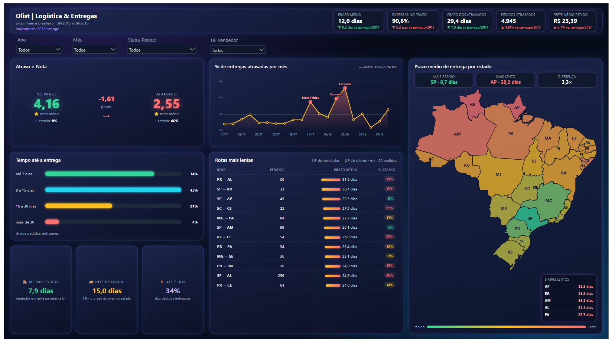
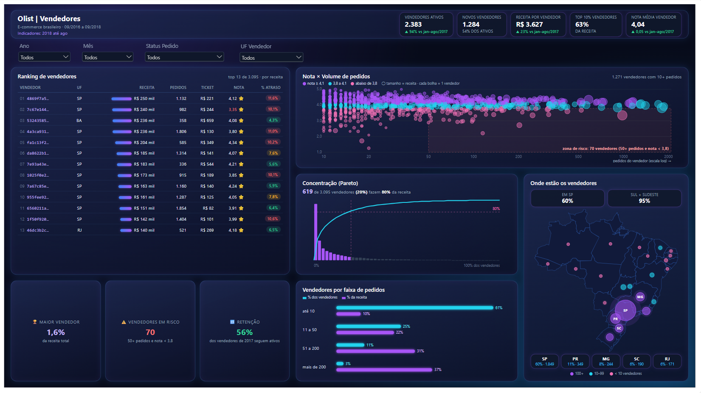

# 🛒 Olist – Pipeline de Dados em Arquitetura Medalhão

Pipeline de dados ponta a ponta com o dataset público de e-commerce brasileiro da **Olist**: ingestão dos arquivos brutos, tratamento e modelagem dimensional no **Databricks (Delta Lake)**, orquestração com **Apache Airflow** e consumo em **Power BI**.

O objetivo é reproduzir, com dados abertos, o tipo de solução usada em ambientes corporativos de dados: camadas bem definidas, regras de qualidade, modelo estrela pronto para BI e execução automatizada.

---

## 🏗️ Arquitetura



| Camada | Conteúdo | Regras principais |
|---|---|---|
| **Bronze** | Cópia fiel dos 9 CSVs em tabelas Delta | Colunas de auditoria (`_ingested_at`, `_source_file`), sem transformação |
| **Silver** | Tabelas limpas e tipadas | Tipos corretos, datas convertidas, deduplicação, padronização de texto, tradução das categorias |
| **Gold** | Modelo dimensional | `fato_vendas`, `dim_cliente`, `dim_produto`, `dim_vendedor`, `dim_data` + agregados |

---

## 🧰 Tecnologias

- **Databricks Free Edition** – processamento com PySpark e armazenamento em Delta Lake (Unity Catalog)
- **Apache Airflow 3** (Docker) – orquestração via `DatabricksRunNowOperator`
- **Power BI** – relatório de 4 páginas sobre a camada gold, com visual customizado em HTML/SVG gerado por DAX
- **SQL** – análises de negócio sobre o modelo final

---

## 📁 Estrutura do repositório

```
olist-medallion-pipeline/
├── notebooks/
│   ├── 01_bronze_olist.py      # ingestão dos CSVs → Delta
│   ├── 02_silver_olist.py      # limpeza e tipagem
│   └── 03_gold_olist.py        # modelo estrela
├── dags/
│   └── olist_medallion_dag.py  # orquestração no Airflow
├── sql/
│   └── analises_negocio.sql    # perguntas de negócio respondidas em SQL
├── powerbi/
│   ├── olist_vendas.pbip       # projeto Power BI (formato PBIP)
│   ├── olist_vendas.Report/
│   ├── olist_vendas.SemanticModel/
│   ├── medidas/                # medidas DAX das 4 páginas
│   ├── img/                    # prints das telas
│   └── README.md               # telas, modelo e técnica
├── docs/
│   └── dicionario_dados.md     # descrição das tabelas gold
├── requirements.txt
└── README.md
```

---

## ▶️ Como executar

### 1. Dados
1. Baixe o dataset [Brazilian E-Commerce Public Dataset by Olist](https://www.kaggle.com/datasets/olistbr/brazilian-ecommerce) no Kaggle.
2. No Databricks, crie o volume e envie os 9 arquivos CSV:
   ```sql
   CREATE SCHEMA IF NOT EXISTS workspace.olist;
   CREATE VOLUME IF NOT EXISTS workspace.olist.raw;
   ```
   Caminho final: `/Volumes/workspace/olist/raw/`

### 2. Databricks
1. Importe a pasta `notebooks/` no workspace (ou conecte este repositório via **Git folders**).
2. Crie **3 Jobs** (Workflows → Jobs), um para cada notebook, e anote o `job_id` de cada um.
3. Gere um token de acesso: **Settings → Developer → Access tokens**.

### 3. Airflow
1. Suba o Airflow com Docker e instale o provider do Databricks (`requirements.txt`).
2. Crie a conexão `databricks_default` (Admin → Connections) com o host do workspace e o token.
3. Crie as variáveis (Admin → Variables):
   - `olist_job_bronze`, `olist_job_silver`, `olist_job_gold` → IDs dos jobs
4. Copie `dags/olist_medallion_dag.py` para a pasta `dags/` do Airflow e ative a DAG.

### 4. Power BI
Conecte no **SQL Warehouse** do Databricks e importe as tabelas do schema `workspace.olist_gold`. Detalhes em [`powerbi/README.md`](powerbi/README.md).

---

## 📊 Relatório Power BI

| Visão geral | Produtos & Categorias |
|---|---|
|  |  |
| **Logística & Entregas** | **Vendedores** |
|  |  |

Detalhes das telas, do modelo e da técnica de HTML via DAX em [`powerbi/README.md`](powerbi/README.md).

---

## ❓ Perguntas de negócio respondidas

- Evolução mensal de faturamento e ticket médio
- Categorias e estados com maior receita
- Percentual de pedidos entregues com atraso por estado
- Relação entre atraso na entrega e nota de avaliação
- Vendedores com maior volume e melhor avaliação

Consultas em [`sql/analises_negocio.sql`](sql/analises_negocio.sql).

---

## 🔜 Próximos passos

- [ ] Carga incremental na silver com `MERGE`
- [ ] Testes de qualidade de dados (contagem, nulos, chaves órfãs)
- [ ] CI/CD com GitHub Actions + Databricks Asset Bundles
- [x] Relatório Power BI com 4 páginas

---

📄 Dados: [Olist – Kaggle](https://www.kaggle.com/datasets/olistbr/brazilian-ecommerce) (licença CC BY-NC-SA 4.0)
