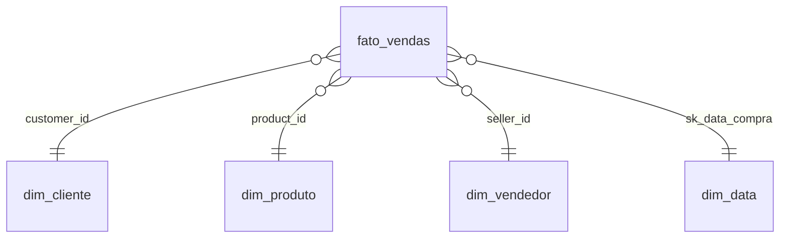

# 📊 Power BI – Olist

Relatório de 4 páginas construído sobre a camada **gold** do pipeline, com visual totalmente customizado em **HTML/CSS/SVG gerado por medidas DAX** (visual *HTML Content*).

---

## 🖥️ Telas

### 1. Visão Geral
KPIs do ano até o momento vs mesmo período do ano anterior (com mini tendências), receita mês a mês com comparação ao ano anterior, categoria destaque, top 5 categorias, entregas no prazo, distribuição das notas e mapa de vendas por estado.

### 2. Produtos & Categorias
Ranking de categorias, curva ABC (Pareto), preço médio × nota, frete por faixa de peso, piores avaliações, efeito da quantidade de fotos no anúncio e destaques automáticos.

### 3. Logística & Entregas
Impacto do atraso na nota, % de entregas atrasadas por mês (com detecção automática de picos), prazo médio por estado, tempo até a entrega, rotas mais lentas (UF vendedor → UF cliente) e comparação mesmo estado × interestadual.

### 4. Vendedores
Ranking de vendedores, nota × volume com zona de risco, concentração de receita (Pareto), distribuição geográfica, faixas de pedidos e retenção.

---

## 💡 Principais insights

- **Atraso derruba a satisfação:** pedidos atrasados têm nota média ~1,6 ponto menor e quase metade recebe 1 estrela.
- **Receita concentrada:** ~18 de 74 categorias respondem por 80% da receita.
- **Logística desigual:** o prazo médio para estados do Norte é mais de 3× o de SP; entregas interestaduais levam quase o dobro do tempo.
- **Picos sazonais de atraso** na Black Friday e no Carnaval.
- **Oportunidade de catálogo:** quase metade da receita vem de anúncios com apenas 1 foto.

---

## 🏗️ Modelo de dados (star schema)

- Fonte: **Databricks SQL Warehouse** → schema `workspace.olist_gold` (modo Import)
- Relacionamentos 1:N com filtro em direção única; `dim_data` marcada como tabela de datas
- Tabela `_Medidas` dedicada para todas as medidas

---

## 🧩 Técnica: dashboard em HTML via DAX

Cada página tem um único visual **HTML Content** alimentado por uma medida DAX que monta o HTML completo:

- **CSS** em uma medida de estilo por página (tema escuro, cards, grid responsivo)
- **Gráficos em SVG** gerados com `CONCATENATEX` (área, linhas, barras, bolhas, rosca e mapas)
- **Mapas do Brasil** com contorno real dos estados (simplificado e embutido na medida)
- **Interatividade** preservada: segmentações nativas do Power BI filtram o HTML; dicas (tooltips) via `<title>` no SVG
- **Regras de negócio** nas medidas: comparação ano até o momento vs ano anterior, descarte automático de meses incompletos (< 10% do maior mês), mínimos de pedidos para rankings

As medidas estão em [`medidas/`](medidas):

| Arquivo | Página | Medida final |
|---|---|---|
| `tela1_visao_geral.dax` | Visão geral | `HTML Dashboard` |
| `tela2_produtos.dax` | Produtos & Categorias | `HTML Produtos` |
| `tela3_logistica.dax` | Logística & Entregas | `HTML Logistica` |
| `tela4_vendedores.dax` | Vendedores | `HTML Vendedores` |

---

## ▶️ Como abrir

1. Abra `olist_vendas.pbip` no **Power BI Desktop** (formato PBIP, versionável no Git).
2. Em **Transformar dados → Configurações da fonte de dados**, aponte para o seu SQL Warehouse do Databricks (hostname + HTTP path) e informe um token de acesso.
3. Atualize os dados.

> Os dados não são versionados: o cache local do modelo (`.pbi/cache.abf`) está no `.gitignore`.
