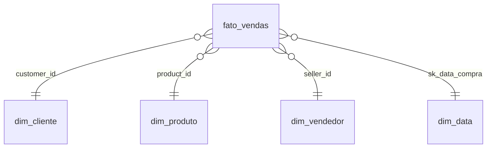

# 📊 Power BI – Olist

Relatório construído sobre a camada **gold** do pipeline.

## Conexão
- Fonte: **Azure Databricks** (SQL Warehouse do workspace)
- Catálogo/schema: `workspace.olist_gold`
- Modo: Import (atualização após a execução da DAG)
- Formato do projeto: **PBIP** (Power BI Project), para versionamento no Git

## Modelo (star schema)



- Relacionamentos 1:N, filtro em direção única (dimensão → fato)
- `dim_data` marcada como tabela de datas

## Medidas DAX principais

```dax
Receita = SUM ( fato_vendas[valor_total] )

Pedidos = DISTINCTCOUNT ( fato_vendas[order_id] )

Ticket Médio = DIVIDE ( [Receita], [Pedidos] )

Receita Ano Anterior =
CALCULATE ( [Receita], SAMEPERIODLASTYEAR ( dim_data[data] ) )

Crescimento YoY % =
DIVIDE ( [Receita] - [Receita Ano Anterior], [Receita Ano Anterior] )

% Entregas com Atraso =
DIVIDE (
    CALCULATE ( [Pedidos], fato_vendas[entregue_com_atraso] = TRUE () ),
    CALCULATE ( [Pedidos], NOT ISBLANK ( fato_vendas[entregue_com_atraso] ) )
)

Nota Média = AVERAGE ( fato_vendas[nota_avaliacao] )
```

## Páginas
1. **Visão executiva** – cartões de KPI, receita mensal com YoY, mapa por UF
2. **Produtos** – receita e participação por categoria
3. **Logística** – % de atraso e prazo médio por UF, atraso × nota
4. **Vendedores** – ranking, receita e avaliação

## Prints
<!-- adicionar imagens em powerbi/img/ e referenciar aqui -->

